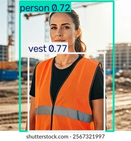

# Helmet detection on construction sites

YOLOv8 model fine-tuned to detect workers with and without a helmet, plus safety vests, in images and videos. On videos each worker is tracked with ByteTrack so they're only counted once, which gives a simple report like "3 workers without a helmet".




## Classes

| id | class | meaning |
|----|-------|---------|
| 0 | helmet | head with a hard hat |
| 1 | no_helmet | head without a hard hat |
| 2 | vest | high-visibility vest |
| 3 | person | worker |

## Dataset

[Construction-PPE](https://docs.ultralytics.com/datasets/detect/construction-ppe) from Ultralytics: 1416 images of construction sites (1132 train, 143 val, 141 test). It has 11 classes, `prepare_data.py` keeps the 4 above and drops the others (gloves, boots, goggles, etc).

Number of boxes after that: helmet 1734, no_helmet 485, vest 1618, person 2245. So no_helmet has far fewer examples than the rest.

## Results

YOLOv8n, image size 640, 50 epochs, trained on CPU (took about 6.3h). Metrics on the test split:

| class     | precision | recall | mAP50 | mAP50-95 |
|-----------|-----------|--------|-------|----------|
| helmet    | 0.916     | 0.922  | 0.933 | 0.509    |
| no_helmet | 0.314     | 0.075  | 0.167 | 0.056    |
| vest      | 0.906     | 0.854  | 0.906 | 0.579    |
| person    | 0.827     | 0.814  | 0.844 | 0.514    |
| all       |           |        | 0.713 | 0.414    |

Helmets, vests and people are detected well. no_helmet is clearly the weak class, probably because there are only 485 examples and the heads are often small.

## Files

- `src/prepare_data.py` - downloads the dataset, keeps the 4 classes, writes data.yaml
- `src/train.py` - fine-tunes yolov8n (pretrained on COCO)
- `src/evaluate.py` - test set metrics, saved in results/metrics.json
- `src/predict.py` - prediction on an image, or tracking + counting on a video
- `notebooks/train_colab.ipynb` - same training on a Colab GPU
- `integration/` - how I plugged the model into the dashboard

## Usage

```bash
pip install -r requirements.txt

python src/prepare_data.py                     # downloads ~180 MB
python src/train.py --epochs 50 --device 0     # --device cpu works too, just slow
python src/evaluate.py
python src/predict.py --source image.jpg
python src/predict.py --source video.mp4
```

Quick test to check everything runs on CPU:

```bash
python src/train.py --epochs 1 --fraction 0.1 --imgsz 320 --device cpu
```

For a video, the script prints how many different workers it saw for each class and warns if some don't have a helmet. The output is saved in `results/predictions/`.

## Counting on videos

The model sometimes switches between helmet and no_helmet on the same person for a few frames. So instead of counting every detection, each track id keeps a count of the labels it got and I take the most frequent one. Tracks shorter than 5 frames are ignored, they're usually false detections.

## Things to improve

- more no_helmet examples (or oversampling) to fix the recall on that class
- try yolov8s or a bigger image size for small heads far from the camera
- more epochs / augmentation, ideally on a GPU
